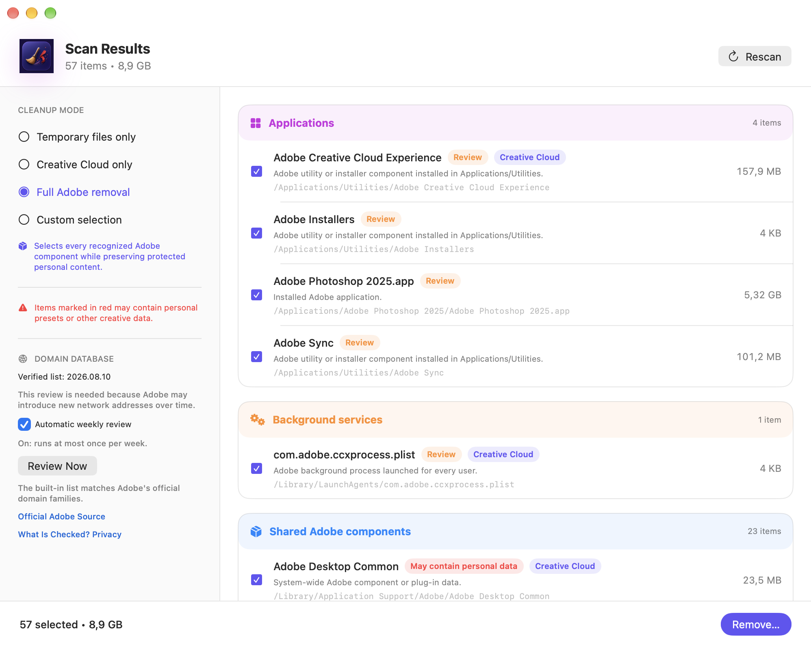
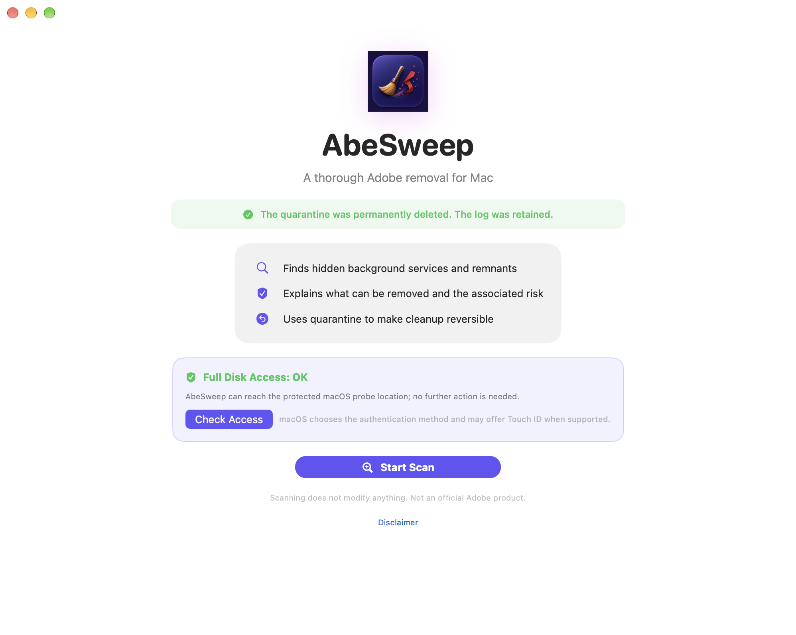

# AbeSweep

Az AbeSweep ingyenes, natív macOS-segédprogram Adobe-telepítések karbantartásához. Segít áttekinteni, mi található a gépen, eltávolítani a kiválasztott összetevőket, és előkészíteni a Macet egy újratelepítésre. Saját gépen és rendszergazdai munka során egyaránt használható.

A hivatalos, notarizált **AbeSweep 1.4** a [macadmin.hu](https://macadmin.hu) oldalról és a [GitHub Releases](https://github.com/macrobi/AbeSweep/releases/tag/v1.4) lapjáról tölthető le. Mindkét helyen ugyanaz a DMG található, amely **macOS 14-től**, Apple Silicon és Intel gépeken működik. A GitHubon a forráskódot böngészheted, hibát jelezhetsz vagy fejlesztési javaslatot tehetsz.

## Hogyan működik?

A vizsgálat összegyűjti az Adobe-alkalmazásokat és a hozzájuk tartozó segédfájlokat, háttérszolgáltatásokat, gyorsítótárakat, naplókat és beállításokat. A találatok mellett láthatod a méretüket és azt, miért kerültek a listába. Az alkalmazás külön jelzi, ha személyes beállítások vagy alkotói munka is érintett lehet. Választhatsz csak ideiglenes fájlokat, Creative Cloud-összetevőket, teljes eltávolítást vagy egyéni kijelölést. A vizsgálat önmagában semmit nem távolít el: a takarítás előtt áttekintheted és jóváhagyhatod a listát.

Az AbeSweep először a megnyitott dokumentumkezelő alkalmazások szabályos bezárását kéri. Ha nyitva maradnak, megáll, hogy legyen lehetőséged elmenteni a munkádat. A kijelölt fájlokat ezután helyi karanténba helyezi, és feljegyzi az eredeti helyüket a visszaállításhoz. Olvasható naplót is készít. Az `/etc/hosts` fájlból ellenőrzött Adobe-bejegyzéseket tud eltávolítani, miközben megőrzi az eredeti fájl ellenőrzött másolatát. Egyes helyek eléréséhez Teljes lemezhozzáférés kell, bizonyos műveletekhez pedig rendszergazdai jóváhagyást kérhet a macOS.

A karanténból megpróbálhatod visszaállítani, amire még szükséged van, de ez nem helyettesíti a biztonsági mentést. A visszaállítás nem ír felül időközben újból létrejött fájlt, és nem tudja visszahozni a hiányzó vagy megváltozott karanténelemeket. A megszakítás biztonságos lépések között történik, ezért eltarthat egy ideig. Hagyd nyitva az AbeSweepet, amíg megpróbálja visszavonni a műveletet, majd nézd át az eredményt és a naplót. A **Karantén végleges törlése** után az érintett fájlok az alkalmazással már nem állíthatók vissza. Takarítás előtt mentsd a munkádat, ellenőrizd a Creative Cloud szinkronizálását, és legyen külön biztonsági mentésed. A további korlátokat és a helyreállítás menetét a [használati útmutató](USAGE.md) írja le.

## Adatvédelem és frissítések

A vizsgálat és a takarítás helyben történik. A találatok, fájlútvonalak, naplók, hosts-tartalom, karantén és Adobe-fiókadatok a Macen maradnak. A Sparkle a macadmin.hu oldalról ellenőrzi az alkalmazásfrissítéseket; a rendszerprofil küldése ki van kapcsolva.

Az Adobe-domainlista felülvizsgálata külön, választható funkció. Kézi indításkor vagy a heti ellenőrzés bekapcsolása után az AbeSweep letölti az Adobe nyilvános hálózati végpontlistáját, és a gépen összehasonlítja a saját listájával. Új telepítésnél ez ki van kapcsolva, az újonnan talált címeket pedig soha nem távolítja el automatikusan. A kiszolgáló a szokásos webes kapcsolathoz hasonlóan láthatja az IP-címet és a kapcsolat technikai adatait. Mindkét hálózati funkcióról a [használati útmutatóban](USAGE.md) olvashatsz bővebben.

## Képernyőképek

A találati listán áttekintheted, mit talált az AbeSweep, és még a módosítások előtt eldöntheted, mit szeretnél eltávolítani.

Az alábbi kezdőképernyő a karantén végleges törlését igazolja vissza. A művelet naplója megmarad.

A képek a projekt készítőjének Macjén készültek, ezért a beállítások és a találatok az adott gép állapotát mutatják.

## Forráskód, licenc és közreműködés

Az AbeSweep forrása megtekinthető, módosítható és továbbadható a [licencben](LICENSE.hu.md) leírt feltételekkel. Magánszemélyek, vállalatok és intézmények ingyen használhatják, fizetett rendszergazdai munkában is. Telepítésért, karbantartásért és támogatásért kérhetsz munkadíjat, magát a szoftvert azonban nem értékesítheted, és fizetős szoftvercsomag részeként sem terjesztheted. A továbbadott módosított változatot át kell nevezni, jelezni kell a változtatásokat, és mellékelni kell a hozzá tartozó forrást, azonos licencfeltételekkel. Rövid összefoglaló az angol [licencismertetőben](../LICENSE-STATUS.md) is található.

Az 1.4-es verzió (build 10400) fordításához Swift 6-ot támogató Xcode szükséges. A Sparkle rögzített 2.9.6-os verzióját a Swift Package Manager tölti le. A fordítási és tesztelési parancsokat a [buildútmutató](BUILDING.md), a módosítások beküldésének menetét a [közreműködési útmutató](../CONTRIBUTING.md) tartalmazza. A saját fordítás és a módosított változat nem hivatalos kiadás. Módosított alkalmazás terjesztésekor a Sparkle-t is ki kell kapcsolni, vagy saját frissítési csatornát és aláírókulcsokat kell beállítani, mert a forrás alapból megtartja a hivatalos csatornát és a nyilvános ellenőrző kulcsot.

Az AbeSweepet a szabadidőmben gondozom. Szívesen fogadok hibajelzéseket és ötleteket, de válaszra vagy javításra nem tudok határidőt ígérni. Nyilvános hibajegyhez csak személyes és bizalmas adatoktól megtisztított naplórészletet csatolj. Biztonsági hibát a [biztonsági útmutató](../SECURITY.md) szerint jelezz.

Az AbeSweep az Adobe-tól független projekt: nem az Adobe Inc. terméke, és a vállalat nem támogatja, nem ellenőrizte és nem hagyta jóvá. Az Adobe, a Creative Cloud és a kapcsolódó terméknevek a jogosultak védjegyei; itt annak leírására szerepelnek, hogy a segédprogram mivel használható.
